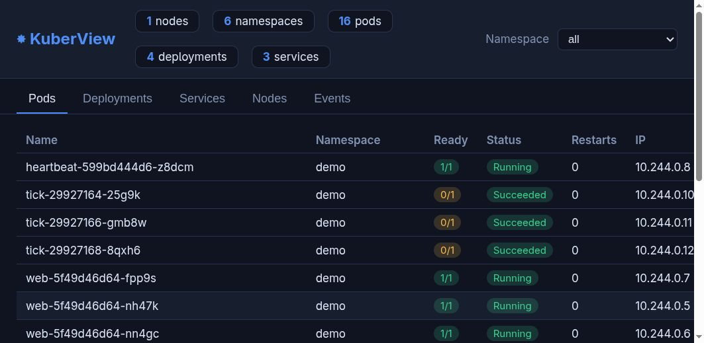

# KuberView

A tiny Kubernetes dashboard, built from scratch to learn Kubernetes by building.

It's a FastAPI app that uses the official [`kubernetes`](https://github.com/kubernetes-client/python)
Python client to read cluster state (via your kubeconfig — the same credentials `kubectl` uses)
and renders it in a single-page web UI: pods, deployments, services, nodes, events, and live pod logs.



## Layout

```
kind-config.yaml          # kind cluster definition (with extended kubeadm timeouts)
manifests/demo-apps.yaml  # sample workloads: nginx deployment, log-producing worker, cronjob
kuberview/
  main.py                 # FastAPI backend — the Kubernetes API calls live here
  requirements.txt
  static/                 # vanilla JS/CSS frontend
```

## Prerequisites

- Docker
- `kubectl` and `kind` (installed in `~/.local/bin`)
- Python 3.12+

## Quick start

```bash
# 1. Create the cluster
kind create cluster --config kind-config.yaml

# 2. Deploy the sample workloads
kubectl apply -f manifests/demo-apps.yaml

# 3. Set up Python env and run the dashboard
python3 -m venv .venv
.venv/bin/pip install -r kuberview/requirements.txt
.venv/bin/uvicorn kuberview.main:app --port 8000
```

Then open <http://127.0.0.1:8000>. Click any pod row to view its logs.

Tear down with `kind delete cluster --name kuberview`.

## API endpoints

| Endpoint | What it shows |
| --- | --- |
| `/api/overview` | counts of nodes/namespaces/pods/deployments/services, pod phases |
| `/api/pods?namespace=` | pod list (all namespaces if omitted) |
| `/api/deployments?namespace=` | deployment rollout status |
| `/api/services?namespace=` | services, types, ports |
| `/api/nodes` | node readiness, versions, capacity |
| `/api/events?namespace=` | 50 most recent cluster events |
| `/api/pods/{ns}/{name}/logs?tail=100` | pod logs |

## Lessons learned setting this up (Fedora)

Two real-world issues hit during cluster creation — both worth knowing:

1. **inotify limits.** kind nodes run many file-watching processes; Fedora's default
   `fs.inotify.max_user_instances=128` gets exhausted on a desktop. Fixed persistently in
   `/etc/sysctl.d/99-kind-inotify.conf`:
   ```
   fs.inotify.max_user_watches = 524288
   fs.inotify.max_user_instances = 512
   ```

2. **kubeadm timeouts on slower machines.** On this machine the apiserver/etcd took several
   minutes to actually serve requests (etcd fsync is disk-heavy), while kubeadm defaults to a
   4-minute control-plane wait and a **1-minute `kubernetesAPICall` timeout** — the latter is
   what kept failing `kubeadm init` with
   `unable to create ClusterRoleBinding: context deadline exceeded`.
   Fixed via `kubeadmConfigPatches` in [kind-config.yaml](./kind-config.yaml) raising the
   `timeouts:` block in `InitConfiguration`.

## Ideas for next steps

- Watch API + WebSockets: push updates instead of polling
- Scale deployments from the UI (`patch_namespaced_deployment_scale`)
- Containerize KuberView and run it **inside** the cluster with a read-only ServiceAccount + RBAC
- Show owner references (Pod → ReplicaSet → Deployment) as a tree
